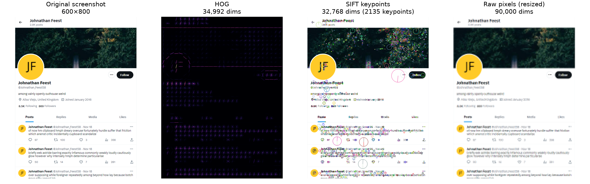
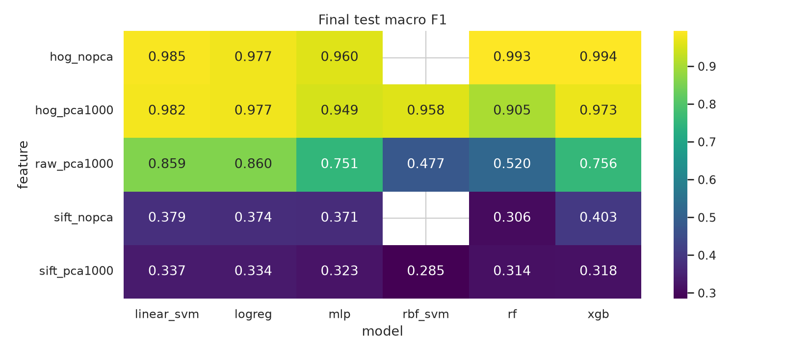
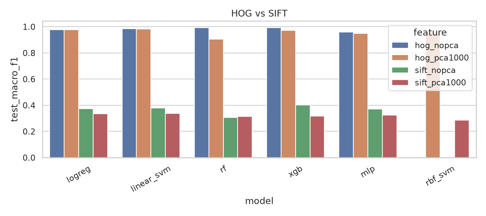
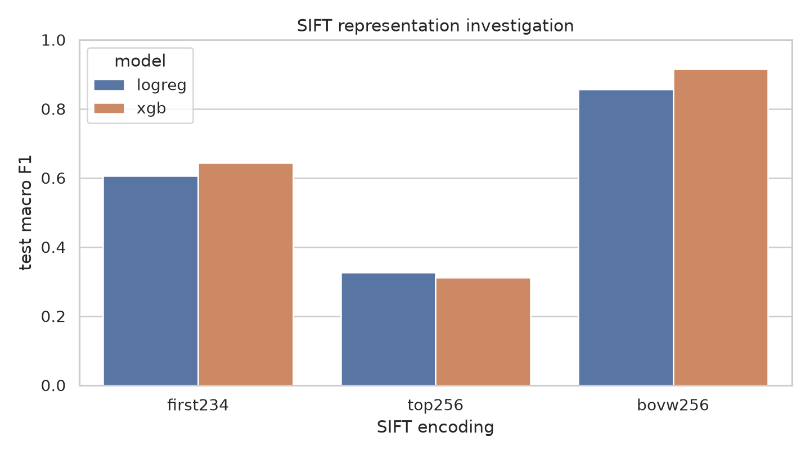
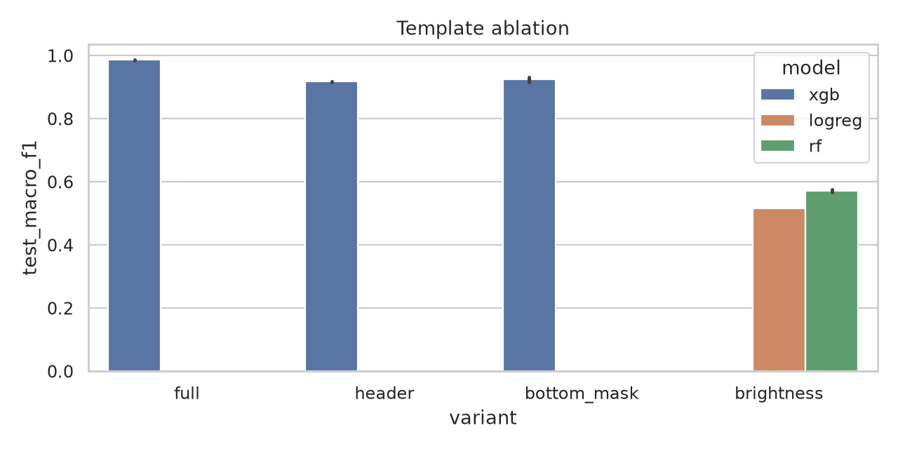
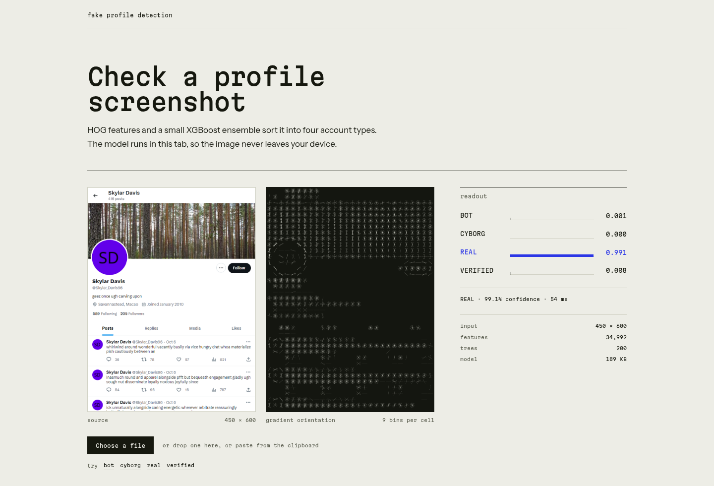

# Fake Profile Detection Benchmark

A script-first research benchmark for classifying social-media profile screenshots into four account types: `BOT`, `CYBORG`, `REAL`, and `VERIFIED`.

The benchmark compares handcrafted image features, classical and GPU-accelerated classifiers, a small MLP, a small CNN, and eight hyperparameter optimizers under an equal evaluation budget. It uses the official dataset splits, train-only preprocessing, and a single held-out test evaluation per final model.

**Best result:** HOG no-PCA + XGBoost reaches **99.35% test macro F1** at 8.8s train time and 0.19 MB. The small CNN reaches **98.07% ± 0.44** at roughly 140× the training cost.

The accuracy reproduces on this dataset, but most of it comes from the synthetic profile template, and the game-based optimizers show no advantage over random search. Those findings are spelled out in [What the thesis tested](#what-the-thesis-tested-and-what-it-showed).

## Research questions

1. Do game-based optimizers (TOW, LCA, DGO) beat classical optimizers (Random Search, TPE, GA, PSO, SA) under the same budget?
2. Which feature representation is stronger: HOG or SIFT?
3. Does PCA help or hurt, and does the answer depend on the classifier?
4. Can classical features plus a GPU-trained MLP match a small end-to-end CNN?
5. How much of the accuracy comes from the profile template rather than account behavior?

## Dataset

The dataset is the public X fake-profile dataset from Hugging Face:

- 15,000 profile screenshots
- Four balanced classes: BOT, CYBORG, REAL, VERIFIED
- Official splits: 10,000 train / 1,000 validation / 4,000 test
- All images are 600×800 RGB screenshots

The dataset is downloaded with `fpd download`. It is not redistributed in this repository.

## Features

| Feature | Configuration | Dimensions |
|---|---|---:|
| HOG | 450×600, 16×16 cells, 2×2 blocks, 9 bins | 34,992 |
| SIFT | top 256 keypoints by response, 128-dim descriptors | 32,768 |
| Raw + PCA | 150×200×3 flattened, PCA to 1,000 | 1,000 |

HOG and SIFT are dimension-matched for a fair comparison. Raw pixels are used only after PCA. The CNN is the only model that consumes raw images end to end.

All scalers and PCA transforms are fit on the training split only.

## What the features see



An example `REAL` profile screenshot and what each extractor produces:

- **HOG** summarizes gradient orientation on a 16×16 cell grid with 2×2 blocks. It highlights edges, text blocks, avatar boundaries, and the overall layout. This is the representation that performs best.
- **SIFT** detects local keypoints and describes each patch with a 128-dimensional descriptor; the benchmark keeps the top 256 by response. It is sparse and local, so it often misses the global page layout. That is visible in the figure: keypoints cluster on text and avatar edges.
- **Raw pixels** are the resized 150×200 RGB image, flattened to 90,000 values and compressed with PCA. It preserves color and coarse layout but is expensive without dimensionality reduction.

## Models

- Logistic Regression
- Linear SVM
- RBF SVM (PCA features only)
- Random Forest
- XGBoost
- MLP with two hidden layers
- Small CNN with three convolutional blocks

The MLP consumes the same feature vectors as the classical models. The CNN consumes raw images.

## Optimizers

Game-based: TOW, LCA, DGO.

Classical: Random Search, TPE, GA, PSO, SA.

Stage A compares all eight optimizers with 60 evaluations and 3 seeds on PCA-1,000 versions of HOG, SIFT, and raw. Population methods use six candidates over ten evaluations per generation period; SA uses 60 steps; Random Search and TPE use 60 trials. Stage B compares models with TPE using 60 evaluations and 3 seeds; the MLP search uses 10 epochs for runtime, and the final MLP retrains for 30 epochs.

Results are reported as mean ± standard deviation across seeds, with best-so-far curves and evaluations to best/95% of best. No p-values are used.

## Fair comparison

- Official 10k / 1k / 4k splits.
- Hyperparameter search on a 2,000-image stratified subset of the official train split and the official 1,000-image validation split.
- Final models retrain on the full 10,000 train + 1,000 validation = 11,000 images.
- The 4,000-image test split is used once per final model.
- Stage A uses PCA-1,000 versions of HOG, SIFT, and raw, with the same search space and 60-evaluation budget for every optimizer. No-PCA comparisons are in Stage B.
- Stage B uses TPE with 60 evaluations and 3 seeds; the MLP search uses 10 epochs, and the final MLP retrains for 30 epochs.
- Random Forest is constrained to `max_features` in {`sqrt`, `log2`} to keep 35k-feature fits tractable.
- The same model seed is used across optimizers; only the optimizer seed varies.
- No early stopping; each evaluation uses a fixed training budget.

## Quickstart

```bash
python -m venv .venv
source .venv/bin/activate
pip install -e ".[dev]"

fpd download
fpd smoke --config configs/smoke.yaml
```

The smoke run uses a small stratified subset, one feature, two models, and two optimizers. It validates the data, feature, optimizer, and tracking pipeline before a GPU run.

## GPU run

Use a RAPIDS image with cuML prebuilt, or follow the conda fallback in [docs/gpu.md](docs/gpu.md).

```bash
bash scripts/setup_gpu.sh

fpd features --config configs/stage_a.yaml
fpd benchmark --config configs/stage_a.yaml
fpd benchmark --config configs/stage_b.yaml
fpd final --config configs/final.yaml
fpd cnn --config configs/cnn.yaml
fpd ablation --config configs/ablation.yaml
fpd plot --config configs/final.yaml
```

A 24 GB GPU is recommended. A 3090 works with RAPIDS 24.10; a Blackwell GPU needs RAPIDS 26.10 / CUDA 13. See [docs/gpu.md](docs/gpu.md).

## Results

All numbers below are on the official 4,000-image test split. Final models were selected by validation macro F1 and retrained on the 11,000 train+validation images.

### Best models

| Feature | Model | Test accuracy | Test macro F1 | Train time | Inference | Model size |
|---|---|---:|---:|---:|---:|---:|
| HOG no-PCA | XGBoost | **99.35%** | **99.35%** | 8.8s | 0.91 ms | 0.19 MB |
| HOG no-PCA | Random Forest | 99.28% | 99.28% | 11.0s | 0.20 ms | 1.06 MB |
| HOG no-PCA | Linear SVM | 98.53% | 98.53% | 111s | 3.88 ms | 272 MB |
| HOG + PCA | Linear SVM | 98.15% | 98.15% | 0.2s | 2.94 ms | 4.15 MB |
| HOG no-PCA | Logistic Regression | 97.75% | 97.73% | 7.5s | 0.23 ms | 0.53 MB |
| HOG + PCA | Logistic Regression | 97.73% | 97.71% | 0.2s | 0.20 ms | 0.02 MB |
| HOG + PCA | XGBoost | 97.25% | 97.26% | 0.7s | 2.00 ms | 0.79 MB |
| HOG no-PCA | MLP | 95.95% | 95.95% | 7.0s | 0.10 ms | 17.1 MB |
| HOG + PCA | RBF SVM | 95.83% | 95.83% | 0.2s | 3.21 ms | 7.4 MB |



### Best per feature

| Feature | Best test macro F1 | Model |
|---|---:|---|
| HOG no-PCA | **0.9935** | XGBoost |
| HOG + PCA | 0.9815 | Linear SVM |
| raw + PCA | 0.8596 | Logistic Regression |
| SIFT no-PCA | 0.4027 | XGBoost |
| SIFT + PCA | 0.3373 | Linear SVM |

### CNN

| Metric | Value |
|---|---:|
| Test macro F1 | **98.07% ± 0.44** (3 seeds) |
| Parameters | 94,212 |
| Model size | 0.37 MB |
| Training time | ~20.9 min per seed |
| Inference batch 1 | 0.21 ms |

The CNN is competitive with HOG + XGBoost but about **1.3 points less accurate** and roughly **140× more expensive to train**. HOG + XGBoost is 99.35% at 8.8s.

### Optimizers

Stage A mean best validation macro F1:

| Optimizer | Mean | Std | Best | Evals to 95% |
|---|---:|---:|---:|---:|
| TPE | 0.7541 | 0.2988 | 0.9970 | 2.94 |
| PSO | 0.7530 | 0.2980 | 0.9970 | 2.17 |
| LCA | 0.7527 | 0.2974 | 0.9970 | 3.56 |
| Random Search | 0.7525 | 0.2992 | 0.9970 | 1.50 |
| GA | 0.7515 | 0.2980 | 0.9970 | 2.11 |
| DGO | 0.7514 | 0.2989 | 0.9970 | 1.89 |
| TOW | 0.7505 | 0.2987 | 0.9970 | **1.39** |
| SA | 0.7496 | 0.2963 | 0.9970 | 2.44 |

No optimizer clearly wins. The spread between optimizers is under **0.5 points**, while the spread across feature/model configurations is about **30 points**. TOW reaches 95% of its best score fastest, but its final mean is slightly lower than TPE/PSO/LCA. The game-based optimizers are competitive, not superior.

### PCA and feature effects

- HOG → HOG + PCA: 99.35% → 98.15% test macro F1. PCA costs about 1.2 points but trains in 0.2s instead of 8.8s.
- SIFT → SIFT + PCA: 40.27% → 33.73%. PCA hurts SIFT.
- raw + PCA: 85.96% best (Logistic Regression / Linear SVM); Random Forest and RBF SVM underperform at 52%/48%.



### SIFT investigation

The SIFT rows above use the benchmark’s fixed top-256-by-response vector. A controlled follow-up on the same 2,000/1,000/4,000 split with fixed Logistic Regression and XGBoost parameters shows that the encoding was the problem:

| SIFT encoding | LR test macro F1 | XGBoost test macro F1 |
|---|---:|---:|
| First 234 descriptors (thesis style) | 0.6062 | 0.6429 |
| Top 256 by response (benchmark) | 0.3265 | 0.3117 |
| Bag of visual words, 256 clusters | 0.8566 | **0.9143** |

The diagnostic uses a fixed 2k training subset, so compare rows within the table. The main SIFT rows above use the full 11k training and TPE.

BoVW SIFT reaches **0.9143** test macro F1 with XGBoost, competitive with raw+PCA and far above the fixed vector. The main SIFT row is a representation limitation, not SIFT’s ceiling.



### Template ablation

| Variant | Test macro F1 |
|---|---:|
| Full screenshot | **98.59%** |
| Header/avatar crop | 91.70% |
| Bottom masked | 92.54% |
| Brightness/edge + LR | 51.62% |
| Brightness/edge + RF | 57.17% |

Masking one template region costs about **6–7 points**, but the model still reaches ~92%. The profile template matters, but it is not the whole signal. Trivial brightness/edge statistics are near chance.



## Trained model

The best configuration is exported as a portable artifact in [`models/hog_xgb`](models/hog_xgb): HOG + XGBoost, a 189 KB booster with a 0.80 MB scaler, no GPU needed.

```bash
pip install -r models/hog_xgb/requirements.txt
python models/hog_xgb/inference.py screenshot.png
```

The exported model reaches **99.28%** test macro F1 after a CPU retrain on the 11,000 train+validation images; the GPU benchmark run reached 99.35% with the same configuration. End to end it needs about 38 ms per image on CPU: 35 ms for HOG and 3 ms for the ensemble. [`models/hog_xgb/README.md`](models/hog_xgb/README.md) is the model card.

To publish it on Hugging Face:

```bash
export HF_TOKEN=hf_...        # or run `hf auth login`
python scripts/upload_model.py --repo-id <user>/<model-name>
```

`scripts/upload_model.py` creates the model repo if needed and uploads the folder. Add `--private` for a private repo.

## Browser demo



Live at **[fpd.abderrahmene.me](https://fpd.abderrahmene.me)**. [`web/`](web) is a static site that runs the same model client-side: no server, no upload, about 54 ms per screenshot in Chromium. It reimplements the preprocessing in JavaScript (OpenCV-compatible area resize, grayscale, skimage-compatible HOG) and walks the 200 exported trees directly.

On 250 held-out test images it agrees with the Python pipeline on **250/250 labels**, with a mean feature difference of 1.4e-5.

```bash
make web   # serves web/ on http://localhost:8799
```

Any static host works. [web/README.md](web/README.md) documents Cloudflare Pages, GitHub Pages, and Hugging Face static Space deployments.

## What the thesis tested, and what it showed

The project began as a graduation thesis. The approach was novel in combination: full-resolution HOG descriptors on profile screenshots, classical classifiers, and game-based metaheuristic optimizers (TOW, LCA, DGO) for hyperparameter search. It reported near-perfect accuracy.

This repository re-ran the idea under controlled conditions. The accuracy reproduces, but the evidence does not support the interpretation that motivated it. The novel component, game-based optimization, produces no measurable gain, and the accuracy comes mostly from the synthetic template rather than from a signal that would transfer to real accounts.

The shortcomings, roughly in order of how much they matter:

1. **Most of the signal is the template, not the account.** Masking one template region costs 6–7 points but still leaves about 92% test macro F1, so the class is largely encoded in layout, badges, and rendering. The same screenshot re-encoded as WebP, or resized up and back down, flips a confident BOT (0.999) to CYBORG (0.898). A classifier that changes its answer under compression has no usable invariance for real screenshots, which are re-rendered by whatever browser and display the user has.

2. **The novel contribution does not hold up.** The eight optimizers span 0.45 points of mean validation macro F1 (0.7496–0.7541) against a 30-point spread across feature and model choices. TOW reaches 95% of its best score in the fewest evaluations (1.39), but its final mean is below TPE, PSO, and LCA. On this evidence, game-based search is a different way to spend a budget, not a better one.

3. **There is no transfer evidence.** Every number is measured on one synthetic dataset with the same generator and template. No real X profile was scored, and no second dataset was used. The compression and resampling result in point 1 is the only cross-condition probe, and it already moves the answer; a live profile rendered by a different browser would sit further out of distribution.

4. **The features carry no account behavior.** HOG sees pixels. It does not see follower graphs, posting cadence, account age, links, or text history, which is where fake-account detection usually finds signal. The classes (`BOT`, `CYBORG`, `REAL`, `VERIFIED`) are dataset labels; `VERIFIED` is a platform state, and `CYBORG` is not an operational category anyone agrees on.

5. **The data is synthetic, balanced, and small.** 15,000 generated screenshots, 25% per class, 600×800. Real prevalence is far lower than 25%. At 99.3% recall and 99.3% specificity, a population with 1% fakes yields about 59% precision, so the balanced test score overstates field performance by a wide margin.

6. **The evaluation is descriptive.** Three seeds, no confidence intervals or tests, one test evaluation per final model, and a model selected by validation score. Optimizer ranks come from a 1,000-image validation split, which is small enough that a 0.45-point spread is noise.

7. **Several comparisons are not perfectly like-for-like.** Stage A tunes on PCA-1,000 features, Random Forest samples `sqrt`/`log2` features rather than all 35k, the MLP searches at 10 epochs and trains at 30, and LCA/DGO are simplified reimplementations. The main SIFT rows use a weak fixed descriptor, which the follow-up shows is a representation artifact (0.9143 with BoVW).

8. **The deployment story is thin.** No calibration, no threshold analysis, no false-positive cost, and no dark-mode, localization, or layout-version coverage. The model has one output and no abstain option, which is the wrong shape for a moderation decision.

What survives is still useful: a reproducible harness, a clear accuracy/cost comparison across features and models, a negative result about game-based optimizers, and a measurement of how much of the accuracy is template. That is a legitimate contribution. It is not the contribution the thesis claimed.

## Artifacts

- `results/evaluations.csv` — every objective evaluation.
- `results/runs.csv` — every optimizer/seed run.
- `results/final.csv` — final test results for every feature/model.
- `results/cnn.csv` — CNN test results.
- `results/ablation.csv` — template-masking and brightness-baseline results.
- `results/metadata.json` — versions, GPU, CUDA, and config.
- `results/plots/` — convergence, heatmap, boxplot, PCA/HOG effects, cost, CNN, ablation, and confusion plots.

The paper-style report is [docs/benchmark.md](docs/benchmark.md).

## Repository layout

```text
src/fpd/
├── config.py
├── data.py
├── features.py
├── search_spaces.py
├── models.py
├── optimizers/
├── benchmark.py
├── final_eval.py
├── cnn.py
├── ablation.py
├── tracking.py
├── plotting.py
└── cli.py
configs/
├── smoke.yaml
├── stage_a.yaml
├── stage_b.yaml
├── final.yaml
├── cnn.yaml
└── ablation.yaml
docs/
├── benchmark.md
└── gpu.md
models/
└── hog_xgb/
    ├── README.md
    ├── inference.py
    └── requirements.txt
web/
├── index.html
├── styles.css
├── app.js
├── hog.js
├── model.js
├── assets/
└── samples/
scripts/
├── setup_gpu.sh
├── export_best_model.py
├── export_web_model.py
├── upload_model.py
├── validate_web_model.py
├── validate_web.mjs
├── make_web_samples.py
├── make_feature_figure.py
├── make_sift_figure.py
└── sift_investigation.py
tests/
```

## Technical limitations

- The main benchmark’s fixed top-256 SIFT vector is weak: 40.27% no-PCA / 33.73% PCA. A controlled follow-up reaches 64.29% with the thesis-style first-234 descriptors and **91.43%** with a 256-word BoVW. Treat the main SIFT rows as a representation limitation, not SIFT’s ceiling.
- Stage A uses PCA-1,000 features to keep the eight-optimizer comparison tractable; no-PCA comparisons are in Stage B. Stage B uses three seeds; the MLP search uses 10 epochs while the final MLP uses 30.
- Random Forest uses `sqrt`/`log2` feature sampling, not all 35k features, to keep the high-dimensional fits tractable.
- LCA and DGO are simplified implementations. They use the same budget and search space but are not bit-for-bit reproductions of the published algorithms.
- GPU results depend on the RAPIDS version recorded in `results/metadata.json`. The completed run used an RTX PRO 4000 Blackwell with RAPIDS 26.10 / CUDA 13. XGBoost on 32k-dimensional no-PCA features can exceed 24 GB of VRAM, so the pipeline frees the CuPy pools, uses `max_bin=64`, and falls back to CPU on out-of-memory.
- The exported model in `models/hog_xgb` was retrained on CPU with a different XGBoost build, so it scores 0.9928 test macro F1 instead of the 0.9935 in `results/final.csv`.

## Citation

Dracewicz, W., & Sepczuk, M. (2024). Detecting Fake Accounts on Social Media Portals—The X Portal Case Study. *Electronics*, 13(13), 2542. https://doi.org/10.3390/electronics13132542

## License

MIT
