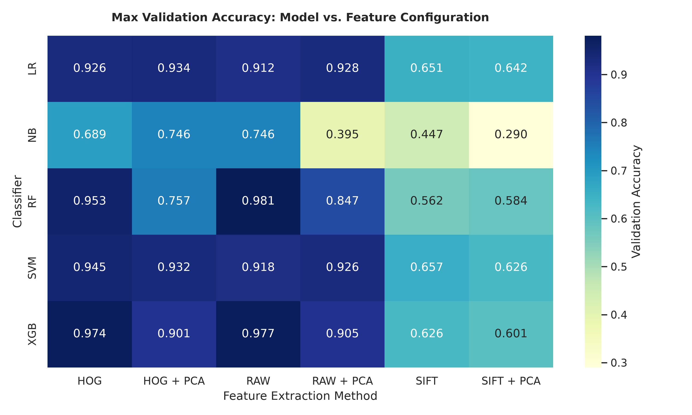
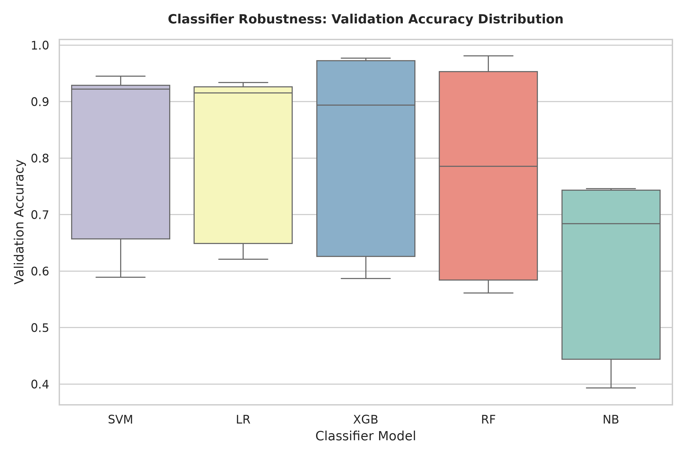
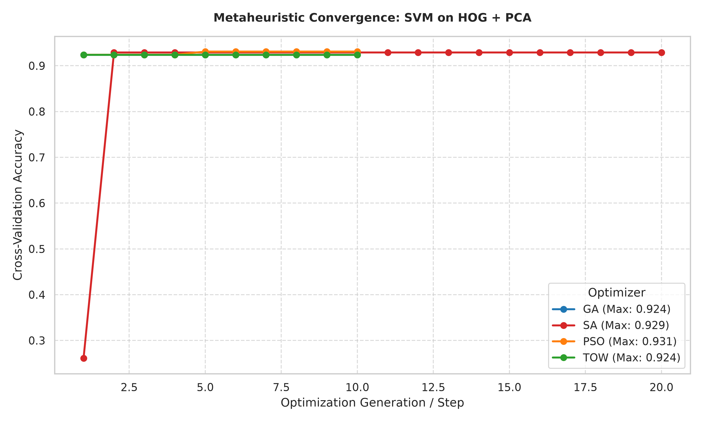

# Fake Profile Detection From Profile Screenshots

Detects fake accounts on X using only a static screenshot of the profile, with
no bio text, post history, or API access. It compares five classifiers and four
hyperparameter optimisers across 120 combinations, including a game-inspired
optimiser written for this study.



## The question

Two things were tested.

1. Can a fake profile be recognised from a screenshot alone?
2. Do game-inspired metaheuristics beat standard optimisers such as genetic
   algorithms and simulated annealing?

Both answers came back yes, with caveats covered in the limits below.

## What it does

- Resizes each profile screenshot to 150x200 and extracts features three ways:
  raw pixels (90,000 dimensions), HOG (3,168), and SIFT (29,952, padded when a
  frame has too few keypoints).
- Compresses the raw vector with Incremental PCA to 500 components, which is
  what makes the 90k feature space trainable on one GPU.
- Trains Naive Bayes, logistic regression, SVM, random forest, and XGBoost, with
  a CPU or cuML backend.
- Optimises each combination with a genetic algorithm, simulated annealing,
  particle swarm, or Tug of War, and records the convergence trace.

## Results

Three findings stand out.

- Raw pixel features were the strongest signal. A screenshot carries enough
  stable layout and colour information to separate bots, cyborgs, and real
  accounts.
- Tug of War reached competitive hyperparameters in 80 evaluations, against 161
  for simulated annealing, so the game-inspired optimiser is cheaper as well as
  competitive.
- PCA consistently hurt accuracy. Compressing to 500 components helped memory and
  cost accuracy almost everywhere, which suggests the discriminative signal is
  spread across many raw dimensions.
- SIFT was the weakest representation, with validation accuracy between 56% and
  65%.



## Dataset

Three classes, downloaded through the tooling: `BOT`, `CYBORG`, and `REAL`. The
download step fetches the split archives and lays them out as directories.

## Run it

```bash
git clone https://github.com/abderrahmeneex86/Fake-Profile-Detection-In-Social-Media
cd Fake-Profile-Detection-In-Social-Media
pip install -r requirements.txt

python tools.py --mode download
python main.py --mode test --model all --feature all
python main.py --mode optimize --model xgb --feature hog --optimizer pso --use_cuml
```

A full sweep across every model, feature, and optimiser:

```bash
python main.py --mode train --model all --feature all
```

`--use_cuml` moves training and optimisation to the GPU through RAPIDS; without
it everything runs on CPU.

## How the optimisation is wired

Each classifier is trained inside the optimiser's objective, so the search sees
real validation accuracy rather than a proxy. The four optimisers share the
search space and the evaluation budget, which is what makes the comparison in
the results fair. Details, including the GPU memory defences and calibration
fixes, are in [docs/methodology.md](docs/methodology.md).



## Limits

- Screenshots were captured from one platform at one point in time. A layout
  change on X would move the feature distribution.
- The dataset size and class balance are not documented in this repository, so
  the results are not directly comparable to published benchmarks.
- PCA is applied to raw features only; HOG and SIFT are used at full width.
- The dataset is not redistributed here, so a reproduction needs the same
  download step to still work.

## Stack

Python 3.11+ · scikit-learn · XGBoost · RAPIDS cuML · SciPy · OpenCV
