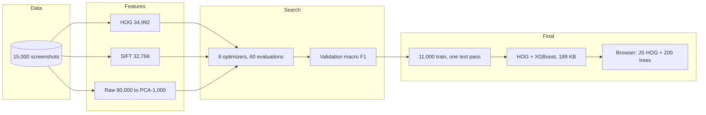

# Fake Profile Detection Benchmark

I built this benchmark to separate what a fake-profile classifier actually learns from what the profile template gives away. It sorts 600×800 X profile screenshots into four dataset classes: `BOT`, `CYBORG`, `REAL`, and `VERIFIED`. The grid compares HOG, SIFT, and raw-pixel features with six classifiers, a small CNN, and eight hyperparameter optimizers under the same evaluation budget, using the official 10k/1k/4k splits and one test pass per final model. HOG + XGBoost reaches 99.35% test macro F1 in 8.8 seconds, and the 189 KB artifact runs in the browser with no backend at [fpd.abderrahmene.me](https://fpd.abderrahmene.me). The ablation is the part worth reading: masking one template region costs 6 to 7 points, and recompressing a screenshot can flip a confident prediction.


_The browser demo on a `REAL` sample from the 4,000-image test split: 99.1% confidence, 54 ms in Chromium. The dark panel is the HOG field the model sees. Nothing is uploaded._

## Contents

- [Results](#results)
- [Dataset](#dataset)
- [Requirements](#requirements)
- [Reproduce](#reproduce)
- [How it works](#how-it-works)
- [Configuration](#configuration)
- [Project layout](#project-layout)
- [Browser demo](#browser-demo)
- [What the thesis showed](#what-the-thesis-showed)
- [Artifacts](#artifacts)
- [Limits](#limits)
- [Citation](#citation)
- [Stack](#stack)

## Results

Final models are selected by validation macro F1, retrained on the 11,000 train + validation images, and evaluated once on the official 4,000-image test split. Times and sizes come from the run recorded in `results/metadata.json`: RTX PRO 4000 Blackwell, RAPIDS 26.10, CUDA 13, Python 3.11.18, XGBoost 3.2.0, scikit-learn 1.9.1. Inference is batch 1 with features precomputed.

| Feature | Model | Test accuracy | Test macro F1 | Train time | Inference | Artifact |
| --- | --- | ---: | ---: | ---: | ---: | ---: |
| HOG, no PCA | XGBoost | 99.35% | 0.9935 | 8.8 s | 0.91 ms | 0.19 MB |
| HOG, no PCA | Random Forest | 99.28% | 0.9928 | 11.0 s | 0.20 ms | 1.06 MB |
| HOG, no PCA | Linear SVM | 98.52% | 0.9853 | 111.0 s | 3.88 ms | 273 MB |
| HOG + PCA-1000 | Linear SVM | 98.15% | 0.9815 | 0.2 s | 2.94 ms | 4.15 MB |
| HOG, no PCA | Logistic Regression | 97.75% | 0.9773 | 7.5 s | 0.23 ms | 0.53 MB |
| HOG + PCA-1000 | Logistic Regression | 97.72% | 0.9771 | 0.2 s | 0.20 ms | 0.02 MB |
| HOG + PCA-1000 | XGBoost | 97.25% | 0.9726 | 0.7 s | 2.00 ms | 0.79 MB |
| HOG, no PCA | MLP | 95.95% | 0.9595 | 7.0 s | 0.10 ms | 17.1 MB |
| HOG + PCA-1000 | RBF SVM | 95.83% | 0.9583 | 0.2 s | 3.21 ms | 7.4 MB |
| raw + PCA-1000 | Logistic Regression | 85.67% | 0.8596 | 0.2 s | 0.21 ms | 0.02 MB |

Best model for each feature family, including the ones the table above leaves out:

| Feature | Best model | Test macro F1 |
| --- | --- | ---: |
| HOG, no PCA | XGBoost | 0.9935 |
| HOG + PCA-1000 | Linear SVM | 0.9815 |
| raw + PCA-1000 | Logistic Regression | 0.8596 |
| SIFT, no PCA | XGBoost | 0.4027 |
| SIFT + PCA-1000 | Linear SVM | 0.3373 |


_All 28 final feature/model combinations. The full table is in `results/final.csv`._

The small CNN reaches **0.9807 ± 0.0044** test macro F1 across three seeds, with 94,212 parameters, a 0.37 MB artifact, about 20.9 minutes per seed on the same GPU, and 0.20 ms batch-1 inference. It is competitive with HOG + XGBoost but 1.3 points less accurate and roughly 140 times more expensive to train.

### Where the accuracy comes from

The template ablation trains the same HOG + XGBoost recipe on 2,000 images and evaluates on the 4,000-image test split. The variants mask or crop parts of the profile layout.

| Variant | Test macro F1 | Std |
| --- | ---: | ---: |
| Full screenshot | 0.9859 | 0.0006 |
| Header/avatar crop | 0.9170 | 0.0020 |
| Bottom masked | 0.9254 | 0.0081 |
| Brightness/edge features + Logistic Regression | 0.5162 | 0.0000 |
| Brightness/edge features + Random Forest | 0.5717 | 0.0036 |


_Three seeds per variant. The full-image number is below the 11k-trained model because this ablation trains on 2,000 images._

Masking one region costs 6 to 7 points and leaves the model near 92%, so the layout carries most of the signal. Trivial brightness and edge statistics stay near chance.

### Optimizers

Stage A compares eight optimizers on PCA-1000 versions of HOG, SIFT, and raw pixels with Logistic Regression and XGBoost, three seeds and 60 evaluations each.

| Optimizer | Mean best validation F1 | Std | Evals to 95% |
| --- | ---: | ---: | ---: |
| TPE | 0.7541 | 0.2988 | 2.94 |
| PSO | 0.7530 | 0.2980 | 2.17 |
| LCA | 0.7527 | 0.2974 | 3.56 |
| Random Search | 0.7525 | 0.2992 | 1.50 |
| GA | 0.7515 | 0.2980 | 2.11 |
| DGO | 0.7514 | 0.2989 | 1.89 |
| TOW | 0.7505 | 0.2987 | 1.39 |
| SA | 0.7496 | 0.2963 | 2.44 |


_The eight optimizers span 0.45 points of mean validation F1. The best model per feature family ranges from 0.3373 to 0.9935, so the optimizer is not the variable that dominates here. TOW reaches 95% of its best score in the fewest evaluations and finishes seventh on mean._

### PCA

| Feature | No PCA | With PCA-1000 | Delta |
| --- | ---: | ---: | ---: |
| HOG, best model | 0.9935 | 0.9815 | −0.0120 |
| SIFT, best model | 0.4027 | 0.3373 | −0.0654 |
| raw pixels | not run | 0.8596 | not comparable |


_Paired PCA and no-PCA runs, three seeds each. PCA is fit on the training portion only._

PCA costs about 1.2 points on HOG and 6.5 points on SIFT. Linear models tolerate it: HOG + PCA Logistic Regression is 0.9771 at 0.2 seconds and 0.02 MB. Tree models lose more: HOG Random Forest drops from 0.9928 to 0.9048, and HOG XGBoost from 0.9935 to 0.9726.

### SIFT encoding

The main SIFT rows use a fixed top-256-by-response descriptor matrix. A follow-up on the same 2,000/1,000/4,000 split with fixed Logistic Regression and XGBoost parameters shows that the encoding was the limit.

| SIFT encoding | Logistic Regression | XGBoost |
| --- | ---: | ---: |
| First 234 descriptors | 0.6062 | 0.6429 |
| Top 256 by response (main benchmark) | 0.3265 | 0.3117 |
| Bag of visual words, 256 clusters | 0.8566 | 0.9143 |


_Compare rows within this table: the follow-up trains on 2,000 images, while the main SIFT rows train on 11,000 with tuned parameters._

BoVW SIFT reaches 0.9143 and remains below HOG at 0.9935. The main SIFT rows measure the fixed descriptor matrix, not SIFT as a representation.

### Confusion matrix

| Class | Precision | Recall | F1 |
| --- | ---: | ---: | ---: |
| BOT | 0.9980 | 1.0000 | 0.9990 |
| CYBORG | 1.0000 | 0.9910 | 0.9955 |
| REAL | 0.9766 | 1.0000 | 0.9881 |
| VERIFIED | 1.0000 | 0.9830 | 0.9914 |

The model makes 26 errors out of 4,000: 2 `CYBORG` → `BOT`, 7 `CYBORG` → `REAL`, and 17 `VERIFIED` → `REAL`. All errors stay between the visually similar classes.


_One pass over the 4,000-image test split. The off-diagonal cells are the 26 errors listed above._

## Dataset

The dataset is [drveronika/x_fake_profile_detection](https://huggingface.co/datasets/drveronika/x_fake_profile_detection) on Hugging Face, pinned at revision `28bc1fbee3aa928ab3d29d9766155a5233465216`. The dataset card lists the license as MIT. It has 15,000 synthetic X profile screenshots at 600×800 in four classes, split 10,000 train, 1,000 validation, and 4,000 test. Each split is balanced: 2,500, 250, and 1,000 images per class. The images are generated, so layout, badges, and text follow the generator's template rather than real X.

```bash
fpd download
```

```text
~/downloads/datasets/x_fake_profile_detection/
├── train/
│   ├── BOT/
│   ├── CYBORG/
│   ├── REAL/
│   └── VERIFIED/
├── validation/
│   └── ...
├── test/
│   └── ...
└── features/          # created on first feature run
```

The downloader extracts the three zips, maps files into class folders by path, renames them to `00000.png` and so on, and checks the class counts. Preprocessing happens in `src/fpd/features.py`:

| Feature | Input | Configuration | Dimensions |
| --- | --- | --- | ---: |
| HOG | RGB, resized to 450×600, grayscale | 16×16 cells, 2×2 blocks, 9 orientations, L2-Hys | 34,992 |
| SIFT | RGB, original size | top 256 keypoints by response, 128-d descriptors | 32,768 |
| Raw | RGB, resized to 150×200 | flattened, StandardScaler then PCA | 90,000 → 1,000 |

Scalers and PCA transforms are fit on the training portion only. The CNN is the only model that reads raw images end to end.

## Requirements

- Python 3.11 or newer (`requires-python = ">=3.11"`).
- NumPy 1.26, pandas 2.2, scikit-learn 1.5, XGBoost 2.1, scikit-image 0.24, OpenCV 4.10, Optuna 4.0, PyYAML 6.0, tqdm 4.66, matplotlib 3.9, seaborn 0.13, psutil 6.0, joblib 1.4, Pillow 10.0, huggingface-hub 0.26 at minimum. All of these come from `pyproject.toml`.
- PyTorch 2.4 or newer for the MLP and CNN (`.[cnn]`).
- GPU is optional. CPU works for the smoke test and for the exported model. The full grid used RAPIDS cuML 26.10 and CUDA 13 on an RTX PRO 4000 Blackwell.
- About 2 GB of disk for the images and about 6 GB for the HOG/SIFT/raw feature caches in my run. `docs/gpu.md` budgets 64 GB for a full GPU host.
- Linux was the only platform I ran. macOS and Windows are untested.

## Reproduce

### Weights

The exported model is in `models/hog_xgb`: `model.ubj` (189 KB), `scaler.joblib` (0.80 MB), the label map, the exact HOG configuration, and `metrics.json`. It is a CPU retrain of the best configuration, not the GPU checkpoint, so it scores 0.9928 test macro F1 instead of 0.9935.

```bash
pip install -r models/hog_xgb/requirements.txt
python models/hog_xgb/inference.py path/to/screenshot.png
```

```text
path/to/screenshot.png: REAL (0.989)  BOT=0.001  CYBORG=0.000  REAL=0.989  VERIFIED=0.010
```

On my CPU, HOG extraction takes about 35 ms and the tree ensemble about 3 ms per image. The model card is [models/hog_xgb/README.md](models/hog_xgb/README.md). To rebuild the artifact from the dataset and the committed `results/final.csv`:

```bash
python scripts/export_best_model.py --device cpu
```

To publish the folder as a Hugging Face model repo, log in first (`hf auth login` or a token in `HF_TOKEN`), then run:

```bash
python scripts/upload_model.py --repo-id <user>/<model-name>
```

### Train

Start with the CPU smoke run. It trains on 200 images and should finish in a few minutes.

```bash
python -m venv venv
source venv/bin/activate
pip install -e ".[dev]"
fpd download
make smoke
```

The run prints one line per configuration and a final test line:

```text
[run] hog_nopca/logreg/random/0 best=0.9... time=...s
[final] hog_nopca logreg test_f1=0.9...
```

The full grid:

```bash
fpd features --config configs/stage_a.yaml
fpd benchmark --config configs/stage_a.yaml
fpd benchmark --config configs/stage_b.yaml
fpd final --config configs/final.yaml
fpd cnn --config configs/cnn.yaml
fpd ablation --config configs/ablation.yaml
fpd plot --config configs/final.yaml
```

Stage A is eight optimizers × three seeds × 60 evaluations on PCA-1000 features. Stage B is five feature configurations × six models with TPE, same budget and seeds, with a 10-epoch MLP during search. The full sequence takes several hours on the GPU. `docs/gpu.md` covers the RAPIDS setup, the Blackwell caveat, and running inside `tmux`.

### Evaluate

`fpd final` retrains the best validation configuration for each feature/model pair on 11,000 images and writes `results/final.csv`. `fpd cnn`, `fpd ablation`, and `fpd plot` write the other tables and the figures.

To check the browser port against Python on held-out images:

```bash
python scripts/validate_web_model.py --count 250
node scripts/validate_web.mjs /tmp/opencode/web-validation-250
```

```text
label agreement      250/250
mean latency         35.5 ms/image
```

The script also reports a mean feature difference of 1.4e-5 and a maximum probability difference of 0.05. The remaining gap comes from OpenCV's resize rounding a few pixels differently from the JavaScript implementation.

## How it works



Each feature extractor writes a cache keyed by the split and the file list, so reruns skip extraction. The search trains one model per evaluation on a stratified 2,000-image subset of train and scores it on the 1,000-image validation split. The optimizer proposes hyperparameters from a per-model search space defined in `src/fpd/search_spaces.py`. After the search, `src/fpd/final_eval.py` picks the best validation row per feature/model, refits on the full 11,000 images, and touches the test split once.

The browser path in `web/` repeats the pipeline in JavaScript: OpenCV-compatible area resize, OpenCV's 8-bit grayscale coefficients, a port of scikit-image's HOG (including its cell averaging), the exported scaler, and a traversal of the 200 exported trees. `scripts/export_web_model.py` checks that the exported trees reproduce XGBoost's margins and probabilities before writing `web/assets`.

## Configuration

Every config key is read by `src/fpd/config.py` or by the stage that owns it. Defaults apply when the key is missing from the YAML file.

| Key | Default | What it does |
| --- | --- | --- |
| `data_dir` | `~/downloads/datasets/x_fake_profile_detection` | Root of the extracted dataset |
| `cache_dir` | `<data_dir>/features` | Feature cache directory |
| `results_dir` | `results` | Where CSVs, metadata, and plots are written |
| `backend` | `cpu` | `gpu` enables cuML and XGBoost CUDA |
| `seeds` | `[0, 1, 2]` | Seeds for the search and repeated runs |
| `seed` | `1337` | Split and preprocessing seed |
| `budget` | `60` | Objective evaluations per optimizer run |
| `search_train_size` | `2000` | Stratified subset used during search |
| `limit_train` | full split | Cap the training split for smoke runs |
| `limit_val` | full split | Cap the validation split |
| `limit_test` | full split | Cap the test split |
| `mlp_epochs` | `30` | MLP training epochs for final fits |
| `mlp_batch_size` | `128` | MLP batch size |
| `cnn_epochs` | `20` | CNN epochs |
| `cnn_batch_size` | `64` | CNN batch size |
| `cnn_lr` | `0.001` | CNN learning rate |
| `cnn_weight_decay` | `0.0001` | CNN AdamW weight decay |
| `features` | none | List of feature blocks with optional `pca_components` |
| `models` | none | Model names: `logreg`, `linear_svm`, `rbf_svm`, `rf`, `xgb`, `mlp` |
| `optimizers` | none | `random`, `tpe`, `ga`, `pso`, `sa`, `tow`, `lca`, `dgo` |
| `ablation_variants` | none | `full`, `header`, `bottom_mask`, `brightness` |

CLI commands and their default configs:

| Command | Default config | What it does |
| --- | --- | --- |
| `fpd download` | none | Fetch and verify the dataset |
| `fpd features` | `configs/stage_a.yaml` | Extract and cache features only |
| `fpd smoke` | `configs/smoke.yaml` | Short CPU run on 200 images |
| `fpd benchmark` | `configs/stage_a.yaml` | Optimizer search |
| `fpd final` | `configs/final.yaml` | Retrain best configs and test once |
| `fpd cnn` | `configs/cnn.yaml` | Train the small CNN |
| `fpd ablation` | `configs/ablation.yaml` | Template and brightness baselines |
| `fpd plot` | `configs/final.yaml` | Regenerate the figures |

Model and web scripts:

| Script | Main flags | What it does |
| --- | --- | --- |
| `scripts/export_best_model.py` | `--data-dir`, `--cache-dir`, `--results`, `--output`, `--device` | Retrain the best row and write `models/hog_xgb` |
| `scripts/export_web_model.py` | `--model-dir`, `--output`, `--rows` | Export trees and scaler to `web/assets`, verify against XGBoost |
| `scripts/validate_web_model.py` | `--count`, `--seed`, `--output` | Write reference features and predictions for the browser check |
| `scripts/validate_web.mjs` | validation directory, assets directory | Replay the sample through the browser code |
| `scripts/make_web_samples.py` | `--data-dir`, `--output`, `--index` | Build the four sample screenshots |
| `scripts/upload_model.py` | `--repo-id`, `--folder`, `--private` | Create a model repo and upload the folder |

## Project layout

| Path | Contents |
| --- | --- |
| `src/fpd/` | Package: data loading, features, models, optimizers, stages, tracking, plotting, CLI |
| `src/fpd/optimizers/` | Random, TPE, GA, PSO, SA, TOW, LCA, DGO implementations |
| `configs/` | Stage A, Stage B, final, CNN, ablation, and smoke configs |
| `models/hog_xgb/` | Best artifact, preprocessing contract, inference script, model card |
| `web/` | Static browser demo and its assets |
| `scripts/` | Model export, web export, validation, sample, and figure scripts |
| `results/` | Committed CSVs, metadata, and figures |
| `docs/` | Full benchmark report, GPU setup, demo screenshot |
| `tests/` | Unit tests for data, features, optimizers, search spaces, and exports |

## Browser demo

The demo at [fpd.abderrahmene.me](https://fpd.abderrahmene.me) runs the exported model in the tab. Drag a screenshot, paste one, or pick one of the four samples. It draws the HOG gradient field for the uploaded image next to the source, then shows the four probabilities with the winning class. There is no server and no upload; the page fetches about 1.2 MB of assets once.

`web/README.md` covers the local server (`make web`, port 8799), the deployment steps for Vercel and other static hosts, and the validation procedure. The browser implementation lives in `web/hog.js`, `web/model.js`, and `web/app.js`.

## What the thesis showed

The project started as a graduation thesis. The proposed combination was full-resolution HOG, classical classifiers, and game-based metaheuristic search. This repository re-ran the idea under controlled conditions, and the evidence changes the story.

1. **The template carries most of the signal.** Masking one region costs 6 to 7 points but still leaves about 92%, and a WebP re-encode or a resize round trip moves a confident `BOT` from 0.999 to 0.898 `CYBORG`. A classifier that changes its answer under compression has no usable invariance for real screenshots.
2. **The optimizer contribution does not hold.** Eight optimizers span 0.45 points of mean validation F1, while the best model per feature family ranges from 0.3373 to 0.9935. TOW reaches 95% of its best score fastest but finishes seventh on mean.
3. **There is no transfer evidence.** Every number comes from one synthetic dataset with the same generator. No real X profile was scored, and no second dataset was used.
4. **The features carry no account behavior.** HOG sees pixels, not follower graphs, posting cadence, account age, links, or text history. `VERIFIED` is a platform state and `CYBORG` is a dataset label, not an agreed operational category.
5. **The data is balanced and small.** 15,000 images at 25% per class. At 99.3% recall and 99.3% specificity, a population with 1% fakes yields about 59% precision, so the balanced test score overstates field performance.
6. **The evaluation is descriptive.** Three seeds, no confidence intervals or tests, one test evaluation per final model, and selection on validation.

What survives is a reproducible harness, a measured accuracy/cost ranking, a negative result about game-based optimizers, and a measurement of the template effect. The full report is [docs/benchmark.md](docs/benchmark.md).

## Artifacts

| Path | Contents |
| --- | --- |
| `results/evaluations.csv` | Every objective evaluation during search |
| `results/runs.csv` | One row per optimizer/seed run |
| `results/final.csv` | Final test results for every feature/model pair |
| `results/cnn.csv` | CNN results for three seeds |
| `results/ablation.csv` | Template masking and brightness baselines |
| `results/sift_investigation.csv` | SIFT encoding follow-up |
| `results/metadata.json` | Versions, GPU, CUDA, and run protocol |
| `results/plots/` | Convergence, heatmap, box plot, PCA, SIFT, CNN, ablation, confusion |

The committed CSVs came from the GPU run described in `results/metadata.json`. Line endings were normalized to LF; the values match the remote run.

## Limits

- **Hardware.** I ran the grid on an RTX PRO 4000 Blackwell with RAPIDS 26.10 and CUDA 13. XGBoost on 32k-dimensional no-PCA features can exceed 24 GB of VRAM; the pipeline frees the CuPy pools, uses `max_bin=64`, and falls back to CPU on out-of-memory. Untested on AMD GPUs and on Apple silicon.
- **Cost.** The full sequence takes several hours on the GPU. CPU feature extraction for the three families takes tens of minutes; the exported model needs about 38 ms per image on my CPU.
- **Disk.** About 2 GB for the dataset, about 6 GB for the feature caches here, and 64 GB budgeted in `docs/gpu.md` for a GPU host.
- **Browser port.** It agrees with Python on 250/250 labels in the validation sample, with a mean feature difference of 1.4e-5 and a maximum probability difference of 0.05. A prediction near a decision boundary can differ in the last digits, and lossy compression or resampling can change the class, as the ablation shows.
- **CPU vs GPU artifact.** The shipped artifact is a CPU retrain at 0.9928 test macro F1. The 0.9935 row comes from the GPU run.
- **Class balance.** The test set is 25% per class. Precision at realistic prevalence is much lower, as the 59% example in the thesis section shows.
- **No calibration or abstain.** The model emits four softmax probabilities and always picks one. There is no threshold analysis, no false-positive cost model, and no abstain option, so it is not a moderation decision system.
- **SIFT.** The main benchmark uses a weak fixed descriptor matrix. The 0.4027 and 0.3373 rows measure that encoding, not SIFT's ceiling.
- **Simplified optimizers.** LCA and DGO follow the published structure and budget but are not bit-for-bit reimplementations.
- **Evaluation.** Three seeds and no formal tests. Differences smaller than the seed standard deviation should not be read as real.
- **Platform.** Reading real X profiles from the DOM was considered and not built; the extension idea depends on a re-render matching the training template, which the compression result makes unlikely.

## Citation

```bibtex
@article{dracewicz2024detecting,
  title   = {Detecting Fake Accounts on Social Media Portals—The X Portal Case Study},
  author  = {Dracewicz, Weronika and Sepczuk, Mariusz},
  journal = {Electronics},
  volume  = {13},
  number  = {13},
  pages   = {2542},
  year    = {2024},
  doi     = {10.3390/electronics13132542}
}

@software{benounene2026fpd,
  title  = {Fake Profile Detection Benchmark},
  author = {Benounene, Abdelrahmane},
  year   = {2026},
  url    = {https://github.com/abderrahmenex86/Fake-Profile-Detection-In-Social-Media}
}
```

## Stack

| Tool | Version in the recorded run | Role |
| --- | --- | --- |
| Python | 3.11.18 (floor 3.11) | Runtime |
| scikit-learn | 1.9.1 (floor 1.5) | Scalers, PCA, linear models, forests |
| XGBoost | 3.2.0 (floor 2.1) | Gradient-boosted trees, GPU hist |
| RAPIDS cuML | 26.10.00 | GPU Logistic Regression, SVM, Random Forest |
| CUDA | 13 | GPU runtime |
| PyTorch | 2.14.1+cu130 (floor 2.4) | MLP and CNN |
| scikit-image | 0.26.0 (floor 0.24) | HOG |
| OpenCV | 5.0.0 (floor 4.10) | Resize, grayscale, SIFT |
| Optuna | 4.0 (floor) | TPE sampler |
| pandas | 2.2 (floor) | Result tables |
| matplotlib / seaborn | 3.9 / 0.13 (floor) | Figures |
| huggingface-hub | 0.26 (floor) | Dataset download, model upload |

The JavaScript port adds no runtime dependency beyond the browser; `web/assets/model.json` (47 KB) and `web/assets/scaler.bin` (273 KB) are the only model files it fetches.
