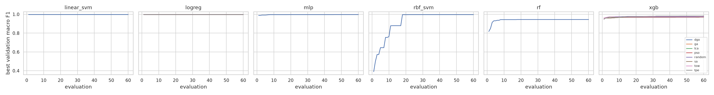
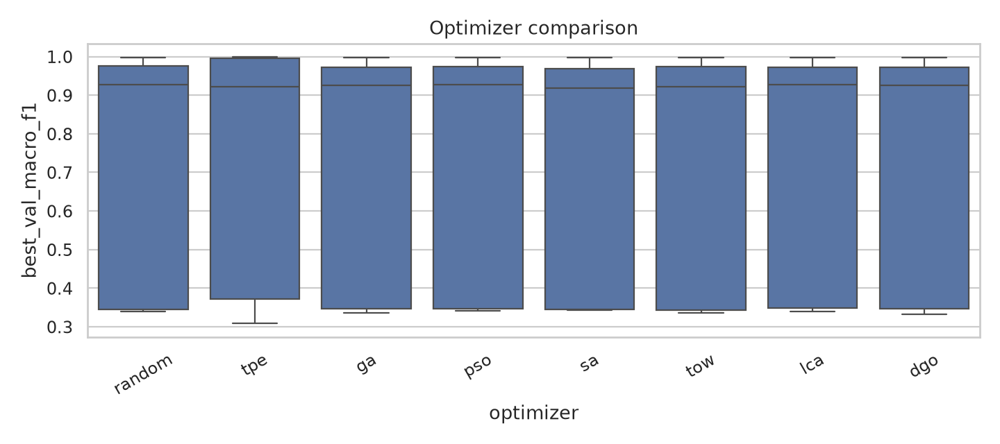
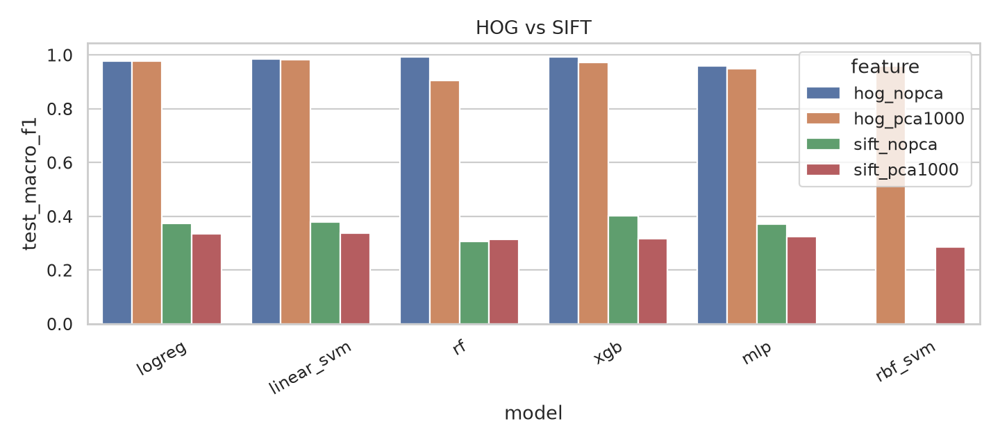
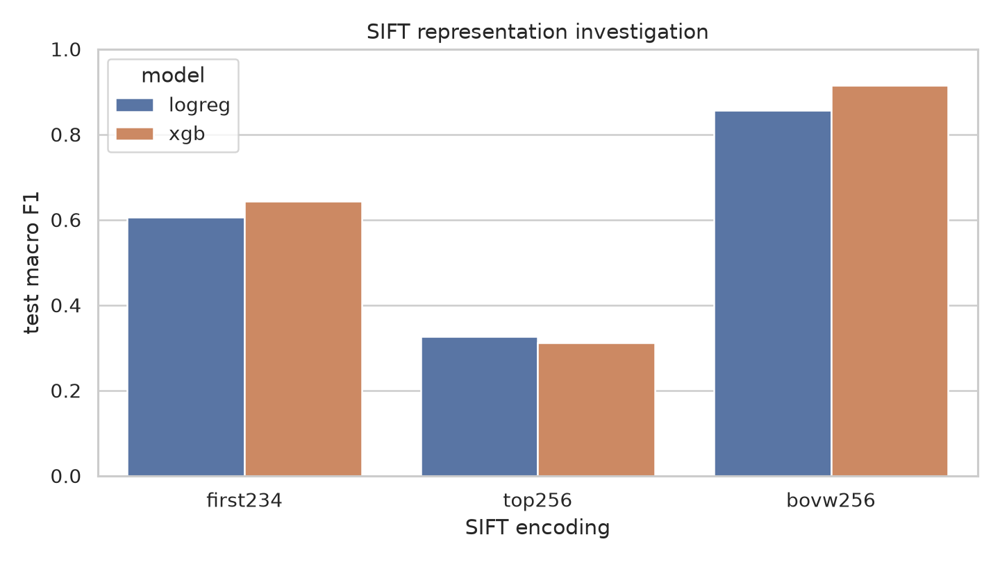
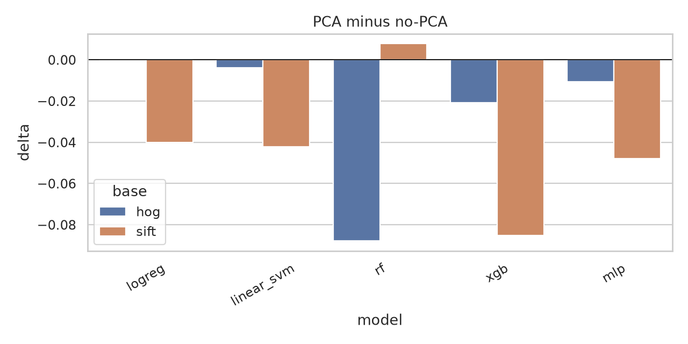
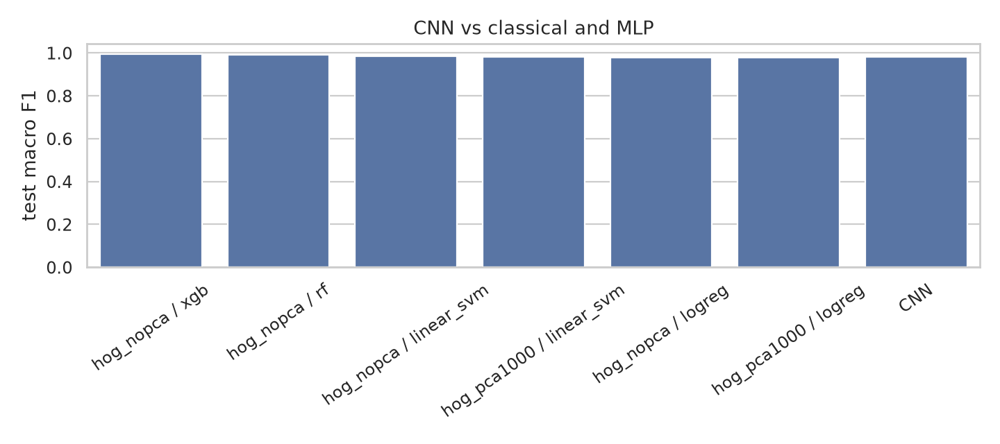
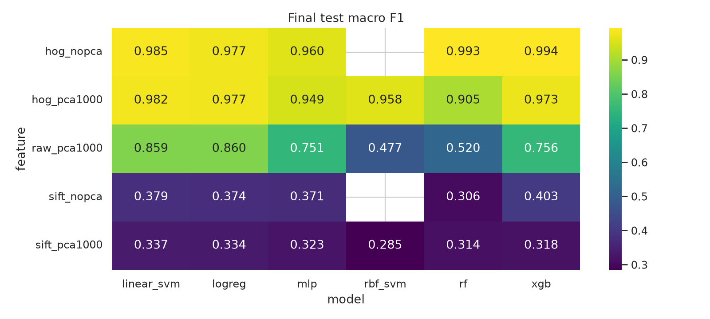
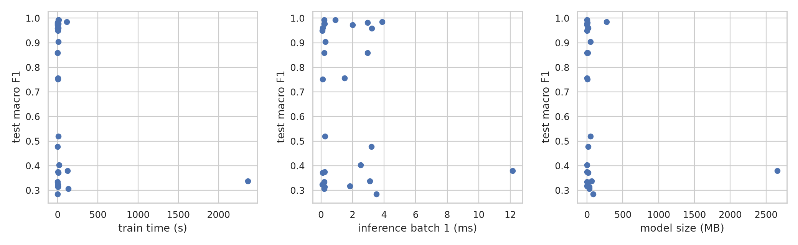
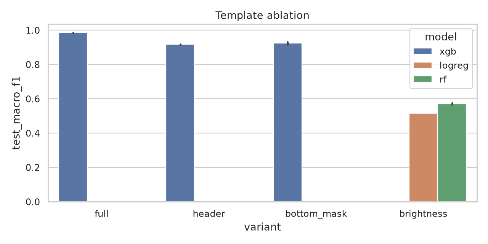
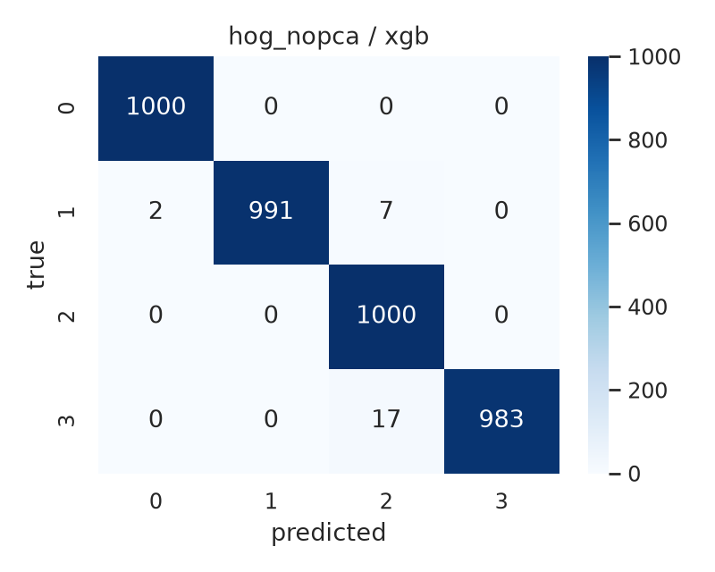

# Benchmark Report

## Abstract

This report evaluates image-based fake-profile detection on the X profile dataset. It compares HOG and SIFT features, PCA and no PCA, classical and GPU-accelerated classifiers, a small MLP, a small CNN, and eight hyperparameter optimizers under an equal evaluation budget. The protocol uses the official dataset splits, train-only preprocessing, and a single held-out test evaluation per final model.

HOG no-PCA with XGBoost reaches **99.35% test macro F1** at 8.8s train time and 0.19 MB. The fixed SIFT vector is far weaker (40.27% no-PCA, 33.73% with PCA); a follow-up shows BoVW SIFT reaches 91.43%. No optimizer clearly wins. The small CNN reaches 98.07% ± 0.44 at roughly 140× the training cost of HOG + XGBoost.

## 1. Introduction

The benchmark answers five questions:

1. Do game-based optimizers (TOW, LCA, DGO) beat classical optimizers (Random Search, TPE, GA, PSO, SA) under the same budget?
2. Which feature representation is stronger: HOG or SIFT?
3. Does PCA help or hurt, and does the answer depend on the classifier?
4. Can classical features plus a GPU-trained MLP match a small end-to-end CNN?
5. How much of the accuracy comes from the profile template rather than account behavior?

## 2. Background

The project started as a graduation thesis on fake-profile detection. The thesis used full-resolution HOG (63,504 dimensions) and reported near-perfect test accuracy. A corrected reproduction on the official test split reached 99.65% macro F1 with full-resolution HOG and XGBoost. That result is useful context, but it is not the benchmark result: full-resolution HOG is roughly twice the size of SIFT and can read the profile template directly.

This benchmark uses a fair 34,992-dimension HOG so that HOG and SIFT are dimension-matched. The template ablation measures how much of the accuracy comes from the template.

## 3. Dataset and split

| Item | Value |
|---|---|
| Images | 15,000 |
| Classes | BOT, CYBORG, REAL, VERIFIED |
| Image size | 600×800 RGB |
| Official train | 10,000 |
| Official validation | 1,000 |
| Official test | 4,000 |
| Class balance | 2,500 / 250 / 1,000 per class |

Hyperparameter search uses a stratified 2,000-image subset of the official train split and the official 1,000-image validation split. Final models retrain on the full 11,000 train+validation images. The 4,000-image test split is used once per final model.

## 4. Features

| Feature | Configuration | Dimensions |
|---|---|---:|
| HOG | 450×600, 16×16 cells, 2×2 blocks, 9 orientations | 34,992 |
| SIFT | top 256 keypoints by response, 128-dim descriptors | 32,768 |
| Raw + PCA | 150×200×3 flattened, PCA to 1,000 | 1,000 |

Scalers and PCA transforms are fit on the training portion only. HOG and SIFT are dimension-matched; raw pixels are used only after PCA. The CNN is the only model that consumes raw images end to end.

SIFT is represented as a fixed top-256 descriptor matrix. This is simpler than a bag-of-visual-words representation and is documented as a limitation.

## 5. Models

| Model | Backend | Notes |
|---|---|---|
| Logistic Regression | cuML / scikit-learn | linear baseline |
| Linear SVM | cuML / scikit-learn | linear max-margin baseline |
| RBF SVM | cuML / scikit-learn | PCA features only |
| Random Forest | cuML / scikit-learn | tree ensemble |
| XGBoost | GPU / CPU | gradient boosting |
| MLP | PyTorch | two hidden layers, feature input |
| CNN | PyTorch | three convolutional blocks, raw image input |

The MLP uses the same feature vectors as the classical models. The CNN uses 150×200 RGB images and has roughly 100k parameters.

## 6. Optimizers and fairness

| Optimizer | Type | Budget |
|---|---|---:|
| Random Search | classical | 60 trials |
| TPE | classical / Bayesian | 60 trials |
| GA | classical | 6 candidates × 10 evaluations |
| PSO | classical | 6 particles × 10 iterations |
| SA | classical | 60 steps |
| TOW | game-based | 6 agents × 10 iterations |
| LCA | game-based | 6 teams × 10 weeks |
| DGO | game-based | 6 players × 10 rounds |

Stage A compares all eight optimizers with the same search space per model, the same 2,000/1,000 search split, the same model seed, and 60 objective evaluations. The optimizer seed varies, and Stage A uses three seeds. Each evaluation trains a model from scratch and scores it on the validation split. Stage A uses PCA-1,000 versions of HOG, SIFT, and raw so the XGBoost fits remain tractable across all eight optimizers; the no-PCA comparisons are in Stage B.

Stage B compares models with TPE using 60 evaluations and three seeds. The MLP search uses 10 epochs for runtime; the final MLP retrains for 30 epochs. Random Forest is constrained to `max_features` in {`sqrt`, `log2`} because a full 35k-feature forest is prohibitively slow.

Results are reported as mean ± standard deviation across seeds. No p-values are used. Best-so-far curves, evaluations to best, and evaluations to 95% of best are reported as descriptive measures.

LCA and DGO are simplified implementations. They preserve the population and evaluation budget but are not bit-for-bit reproductions of the published algorithms.

## 7. Experimental protocol

1. Download the official dataset.
2. Extract HOG, SIFT, and raw+PCA features on the official train, validation, and test splits.
3. Build the stratified 2,000-image search split from the official train split.
4. Fit the scaler and PCA on the search train split.
5. Run Stage A on PCA-1,000 features with every optimizer for 60 evaluations and three seeds; run Stage B with TPE for 60 evaluations and three seeds.
6. Select the best configuration per feature/model by validation macro F1.
7. Retrain the selected configuration on the full 11,000 train+validation images.
8. Evaluate once on the official 4,000-image test split.
9. Train the CNN with the fixed recipe and three seeds.
10. Run the template ablation and brightness baseline.
11. Generate the tables and figures.

## 8. Results

The results are generated by the pipeline and written to:

- `results/evaluations.csv`
- `results/runs.csv`
- `results/final.csv`
- `results/cnn.csv`
- `results/ablation.csv`
- `results/metadata.json`
- `results/plots/`

### 8.1 Optimizer comparison

Stage A used PCA-1,000 versions of HOG, SIFT, and raw, with Logistic Regression and XGBoost, eight optimizers, three seeds, and 60 evaluations.

| Optimizer | Mean best validation F1 | Std | Best | Evals to 95% | Wall-clock (s) |
|---|---:|---:|---:|---:|---:|
| TPE | **0.7541** | 0.2988 | 0.9970 | 2.94 | 71.38 |
| PSO | 0.7530 | 0.2980 | 0.9970 | 2.17 | 47.89 |
| LCA | 0.7527 | 0.2974 | 0.9970 | 3.56 | 55.60 |
| Random Search | 0.7525 | 0.2992 | 0.9970 | 1.50 | 86.45 |
| GA | 0.7515 | 0.2980 | 0.9970 | 2.11 | 44.09 |
| DGO | 0.7514 | 0.2989 | 0.9970 | 1.89 | 57.52 |
| TOW | 0.7505 | 0.2987 | 0.9970 | **1.39** | 64.32 |
| SA | 0.7496 | 0.2963 | 0.9970 | 2.44 | 59.25 |

No optimizer clearly wins. The spread between optimizer means is under **0.5 points**, while the spread across feature/model configurations is about **30 points**. TOW reaches 95% of its best score in the fewest evaluations, but its final mean is slightly lower than TPE, PSO, and LCA. GA has the lowest wall-clock time; Random Search has the highest because it spends more evaluations on expensive configurations.

The game-based optimizers are competitive, not superior. This does not reproduce a TOW advantage.





### 8.2 HOG vs SIFT

| Feature | Best test macro F1 | Best model |
|---|---:|---|
| HOG no-PCA | **0.9935** | XGBoost |
| HOG + PCA | 0.9815 | Linear SVM |
| SIFT no-PCA | 0.4027 | XGBoost |
| SIFT + PCA | 0.3373 | Linear SVM |

HOG is decisively stronger. The benchmark’s fixed top-256 SIFT vector reaches 0.4027 without PCA and 0.3373 with PCA. This is far below the thesis’s SIFT numbers (roughly 0.62–0.74), so a follow-up tested the encoding.

#### SIFT representation follow-up

| SIFT encoding | Logistic Regression test macro F1 | XGBoost test macro F1 |
|---|---:|---:|
| First 234 descriptors (thesis style) | 0.6062 | 0.6429 |
| Top 256 by response (benchmark) | 0.3265 | 0.3117 |
| Bag of visual words, 256 clusters | 0.8566 | **0.9143** |

The follow-up uses the same 2,000/1,000/4,000 split and fixed LR/XGBoost parameters. Compare rows within this table; the main SIFT rows use the full 11k training and TPE. The encoding was the problem: the thesis-style first-234 vector recovers 0.6429, and BoVW reaches 0.9143, competitive with raw+PCA and far above the fixed vector. The main SIFT rows measure the fixed descriptor matrix, not SIFT’s ceiling. BoVW SIFT is still well below HOG’s 0.9935.





### 8.3 PCA vs no PCA

| Feature | No PCA | With PCA | Delta |
|---|---:|---:|---:|
| HOG, best model | 0.9935 | 0.9815 | −0.0120 |
| SIFT, best model | 0.4027 | 0.3373 | −0.0654 |
| raw | — | 0.8596 | — |

PCA costs about **1.2 points** on HOG and **6.5 points** on SIFT. The effect is model-dependent:

- HOG Random Forest: 0.9928 → 0.9048 (−0.0880)
- HOG XGBoost: 0.9935 → 0.9726 (−0.0209)
- HOG Linear SVM: 0.9853 → 0.9815 (−0.0038)
- HOG Logistic Regression: 0.9773 → 0.9771 (−0.0002)
- SIFT XGBoost: 0.4027 → 0.3176 (−0.0851)
- SIFT Linear SVM: 0.3794 → 0.3373 (−0.0421)
- SIFT MLP: 0.3713 → 0.3233 (−0.0480)
- SIFT Random Forest: 0.3064 → 0.3142 (+0.0078)

Linear models tolerate PCA; tree models lose more. Raw + PCA is best with Logistic Regression / Linear SVM at **0.8596**, while Random Forest and RBF SVM fall to 0.5197 and 0.4772.



### 8.4 Classical, MLP, and CNN

| Feature | Model | Test accuracy | Test macro F1 | Train time | Inference | Model size |
|---|---|---:|---:|---:|---:|---:|
| HOG no-PCA | XGBoost | **99.35%** | **0.9935** | 8.8s | 0.91 ms | 0.19 MB |
| HOG no-PCA | Random Forest | 99.28% | 0.9928 | 11.0s | 0.20 ms | 1.06 MB |
| HOG no-PCA | Linear SVM | 98.53% | 0.9853 | 111s | 3.88 ms | 272 MB |
| HOG + PCA | Linear SVM | 98.15% | 0.9815 | 0.2s | 2.94 ms | 4.15 MB |
| HOG no-PCA | Logistic Regression | 97.75% | 0.9773 | 7.5s | 0.23 ms | 0.53 MB |
| HOG + PCA | Logistic Regression | 97.73% | 0.9771 | 0.2s | 0.20 ms | 0.02 MB |
| HOG + PCA | XGBoost | 97.25% | 0.9726 | 0.7s | 2.00 ms | 0.79 MB |
| HOG no-PCA | MLP | 95.95% | 0.9595 | 7.0s | 0.10 ms | 17.1 MB |
| HOG + PCA | RBF SVM | 95.83% | 0.9583 | 0.2s | 3.21 ms | 7.4 MB |
| raw + PCA | Logistic Regression | 85.68% | 0.8596 | 0.2s | 0.21 ms | 0.02 MB |
| raw + PCA | Linear SVM | 85.80% | 0.8591 | 0.4s | 2.95 ms | 8.53 MB |
| raw + PCA | XGBoost | 75.78% | 0.7563 | 1.4s | 1.49 ms | 1.10 MB |
| raw + PCA | MLP | 75.20% | 0.7509 | 2.1s | 0.09 ms | 2.46 MB |
| SIFT no-PCA | XGBoost | 43.35% | 0.4027 | 17.3s | 2.52 ms | 0.87 MB |
| SIFT + PCA | Linear SVM | 34.40% | 0.3373 | 2367s | 3.11 ms | 61.4 MB |

The small CNN reaches **98.07% ± 0.44** test macro F1 with 94,212 parameters, 0.37 MB, and ~20.9 minutes per seed. It is competitive, but HOG + XGBoost is **1.3 points more accurate** and roughly **140× cheaper to train**, with precomputed HOG features. The CNN is faster at inference (0.21 ms vs 0.91 ms).

The MLP is competitive on HOG (0.9595) but below XGBoost and RF. It does not close the gap to the CNN.





### 8.5 Cost and accuracy

| Model | Train time | Inference batch 1 | Model size |
|---|---:|---:|---:|
| HOG + XGBoost | 8.8s | 0.91 ms | 0.19 MB |
| HOG + Random Forest | 11.0s | 0.20 ms | 1.06 MB |
| HOG + Linear SVM | 111s | 3.88 ms | 272 MB |
| HOG + PCA + Linear SVM | 0.2s | 2.94 ms | 4.15 MB |
| HOG + PCA + Logistic Regression | 0.2s | 0.20 ms | 0.016 MB |
| HOG + MLP | 7.0s | 0.10 ms | 17.1 MB |
| CNN | 1251s | 0.21 ms | 0.37 MB |
| SIFT no-PCA + Linear SVM | 124s | 12.16 ms | 2.66 GB |

HOG + XGBoost is the best accuracy/cost tradeoff. HOG + PCA + Logistic Regression is the cheapest accurate model, at 0.2s train and 0.016 MB, with 0.9771 test macro F1. The SIFT linear SVM is a memory outlier at 2.66 GB.



### 8.6 Template ablation

| Variant | Test macro F1 | Std |
|---|---:|---:|
| Full screenshot | **0.9859** | 0.0006 |
| Header/avatar crop | 0.9170 | 0.0020 |
| Bottom masked | 0.9254 | 0.0081 |
| Brightness/edge + LR | 0.5162 | 0.0000 |
| Brightness/edge + RF | 0.5717 | 0.0036 |

Masking one template region costs about **6–7 points**, but the model still reaches ~92%. The profile template matters, but it is not the whole signal. Trivial brightness and edge statistics are near chance (52–57%). The ablation uses the 2,000-image search subset, so the full-image number (0.9859) is slightly below the final 11k-trained model (0.9935).



### 8.7 Best confusion matrix

The best final model is HOG no-PCA + XGBoost. On the 4,000-image test split:

| Class | Precision | Recall | F1 |
|---|---:|---:|---:|
| BOT | 0.9980 | 1.0000 | 0.9990 |
| CYBORG | 1.0000 | 0.9910 | 0.9955 |
| REAL | 0.9766 | 1.0000 | 0.9881 |
| VERIFIED | 1.0000 | 0.9830 | 0.9914 |

```text
BOT      : 1000 / 1000
CYBORG   :  991 / 1000   (2 → BOT, 7 → REAL)
REAL     : 1000 / 1000
VERIFIED :  983 / 1000   (17 → REAL)
```

The model makes 26 errors out of 4,000. The remaining errors are CYBORG→REAL and VERIFIED→REAL, which is consistent with the visual similarity between those classes.



## 9. Threats to validity

- The dataset is synthetic. Layout, text, badges, and template cues are highly correlated with the label. The template ablation measures this but does not eliminate it.
- Both stages use three seeds. The Stage B MLP search uses 10 epochs, while the final MLP uses 30. These provide descriptive stability, not formal inference. Differences smaller than the seed standard deviation should not be interpreted as real.
- The 1,000-image official validation split is small. Optimizer ranking is therefore noisy.
- Random Forest uses `sqrt`/`log2` feature sampling, not all 35k features, to keep the Stage B runtime tractable.
- Stage A uses PCA-1,000 features; full no-PCA optimizer comparisons are not included. This keeps the eight-optimizer matrix within the runtime budget.
- LCA and DGO are simplified implementations.
- SIFT is represented by a fixed top-256 descriptor matrix in the main benchmark. A controlled follow-up reaches 0.6429 with first-234 and 0.9143 with BoVW-256; the main SIFT rows are a representation limitation, not SIFT’s ceiling.
- The completed run used an RTX PRO 4000 Blackwell with RAPIDS 26.10 / CUDA 13. XGBoost on 32k-dimensional no-PCA features can exceed 24 GB of VRAM; the pipeline frees the CuPy pools, uses `max_bin=64`, and falls back to CPU if a fit still runs out of memory.
- GPU results depend on the RAPIDS, CUDA, and PyTorch versions recorded in `results/metadata.json`.
- The final model is selected by validation macro F1 across optimizers and seeds. This selection can be optimistic on the test split.

## 10. Conclusion

No game-based optimizer beat the strongest classical baselines. TPE and PSO have the highest Stage A means, with LCA third; the spread between all eight optimizers is under 0.5 points. TOW reaches 95% of its best score in the fewest evaluations (1.39), yet its final mean is slightly lower than TPE’s. The optimizer choice is not the dominant factor in this benchmark.

HOG is decisively stronger than the benchmark’s fixed SIFT vector. HOG no-PCA reaches 0.9935 test macro F1 with XGBoost; SIFT no-PCA reaches 0.4027. With PCA, HOG is 0.9815 and SIFT is 0.3373. A follow-up shows the representation was the problem: first-234 SIFT reaches 0.6429 and BoVW SIFT reaches 0.9143 test macro F1. SIFT is not a dead end, but even BoVW SIFT remains below HOG.

PCA costs about 1.2 points on HOG and 6.5 points on SIFT. Linear models tolerate PCA; tree models lose more. HOG + PCA + Logistic Regression is the cheapest accurate model (0.9771, 0.2s, 0.016 MB), while HOG + XGBoost is the best overall (0.9935, 8.8s, 0.19 MB).

The small CNN reaches 0.9807 ± 0.0044 test macro F1. It is competitive, but HOG + XGBoost is 1.3 points more accurate and roughly 140× cheaper to train. The MLP reaches 0.9595 on HOG and does not close the gap to the CNN.

The template ablation shows a 6–7 point drop when one region is masked, but the model still reaches ~92%. Trivial brightness and edge statistics are near chance (0.52–0.57). The profile template matters, but it is not the whole signal.

Overall, HOG plus a gradient-boosted tree ensemble is the best accuracy/cost tradeoff in this benchmark. PCA is useful for cheap linear models. Game-based optimizers are competitive but not superior. SIFT needs a better encoding before any conclusion about the representation itself. All results are descriptive: three seeds, no p-values, and a final model selected on validation before a single test evaluation.

## 11. Reproducibility

```bash
fpd download
fpd features --config configs/stage_a.yaml
fpd benchmark --config configs/stage_a.yaml
fpd benchmark --config configs/stage_b.yaml
fpd final --config configs/final.yaml
fpd cnn --config configs/cnn.yaml
fpd ablation --config configs/ablation.yaml
fpd plot --config configs/final.yaml
```

The exact command, config, versions, and GPU are recorded in `results/metadata.json`.
